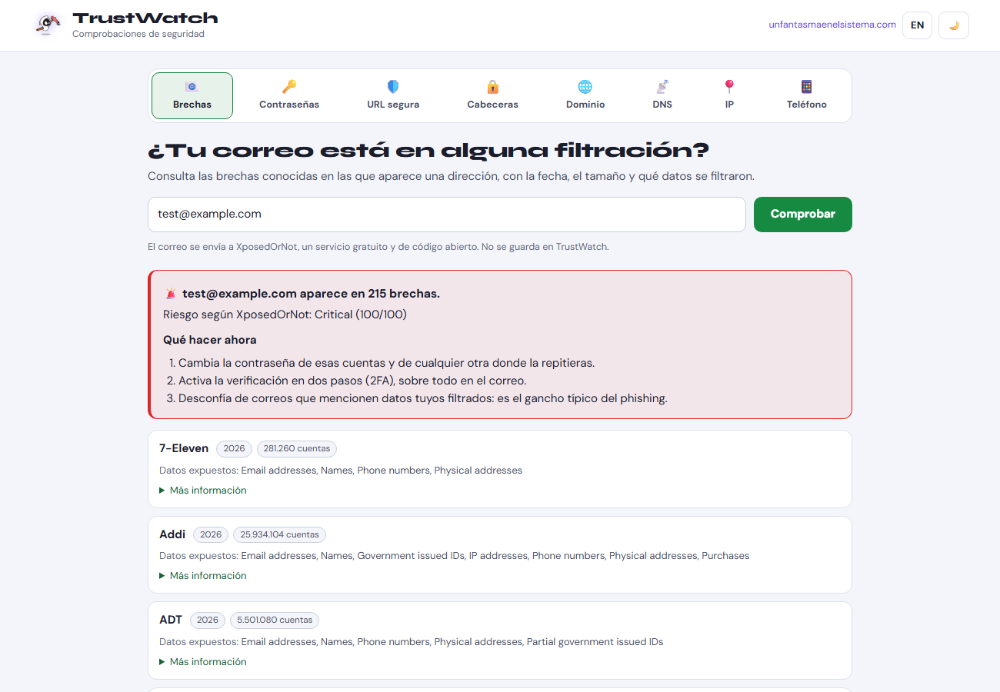

<p align="center">
  <a href="https://www.unfantasmaenelsistema.com"></a>
</p>

<h1 align="center">TrustWatch</h1>

<p align="center">
  <b>Comprobaciones de seguridad en un solo sitio</b><br>
  ¿Tu correo está filtrado? ¿Es fuerte tu contraseña? ¿Es segura esa web? ¿Quién está detrás de ese dominio?
</p>

<p align="center">
  <a href="https://unfantasmaenelsistema.github.io/TrustWatch/"><b>▶ Abrir TrustWatch</b></a> ·
  <a href="https://www.unfantasmaenelsistema.com">unfantasmaenelsistema.com</a> ·
  <a href="LICENSE">MIT</a>
</p>



## Herramientas

| Pestaña | Qué hace | Servicio |
|---|---|---|
| 📧 **Brechas** | Brechas en las que aparece un correo, con año, número de cuentas, datos expuestos, nivel de riesgo y qué hacer | [XposedOrNot](https://xposedornot.com) (directo) |
| 🔑 **Contraseñas** | Generador con `crypto.getRandomValues` y medidor de fuerza (entropía, palabras comunes, secuencias, años, patrones), con tiempo de ataque offline y online | En tu navegador |
| | ¿Ha aparecido en filtraciones? Consulta anónima por *k-anonimato*: solo se envían 5 caracteres del hash SHA-1 | [Have I Been Pwned](https://haveibeenpwned.com/Passwords) |
| 🛡️ **URL segura** | ¿Está catalogada como malware, phishing o software no deseado? | Google Safe Browsing (proxy en Vercel) |
| 🔒 **Cabeceras** | HSTS, CSP, X-Content-Type-Options, X-Frame-Options, Referrer-Policy y Permissions-Policy, con puntuación | Proxy en Vercel |
| 🌐 **Dominio** | Fecha de registro (avisa si tiene menos de 90 días), caducidad, registrador, estado, DNSSEC, y seguridad del correo: MX, SPF y DMARC | RDAP + Google Public DNS |
| 📡 **DNS** | A, AAAA, MX, TXT, NS, CNAME, SOA y CAA, con validación DNSSEC | Google Public DNS |
| 📍 **IP** | País, ciudad, proveedor, ASN y mapa | ipapi.co |
| 📱 **Teléfono** | País, tipo de línea (avisa de las de tarificación adicional) y formatos, con enlaces a denuncias de spam | libphonenumber, en tu navegador |

Interfaz en español e inglés, tema oscuro y claro, y diseño para móvil. La pestaña queda en la URL (por ejemplo, `#domain`) para enlazar directamente a ella.

## Privacidad

- Solo se envía a cada servicio lo imprescindible para su consulta. El generador, el medidor y el análisis de teléfonos no salen del navegador.
- La contraseña nunca se envía: para Have I Been Pwned se calcula su SHA-1 en local y solo viajan los 5 primeros caracteres.
- TrustWatch no tiene analítica ni guarda nada en servidores. En el navegador solo se recuerdan el idioma y el tema.
- Todo lo que llega de fuera (registros DNS, cabeceras de la web analizada, nombres de brechas) se muestra como texto: nunca se interpreta como HTML.

## Proxy en Vercel (`api/`)

Safe Browsing necesita una clave de Google que no debe ir en el navegador, y un navegador no puede leer las cabeceras de otra web. Para eso están las dos funciones de `api/`, desplegadas en `https://trust-watch.vercel.app`:

- `api/safebrowsing.js`: `POST {url}`. Lee la clave de la variable de entorno `GOOGLE_SAFEBROWSING_API_KEY`.
- `api/headers.js`: `GET ?url=`. Bloquea redes internas (también tras redirecciones), corta a los 8 segundos y solo acepta los puertos 80, 443, 8080 y 8443.
- `api/_security.js`: CORS limitado a `unfantasmaenelsistema.github.io` y a `localhost`, validación de URL y protección contra SSRF.

Para desplegarlo: importa el repositorio en Vercel, añade `GOOGLE_SAFEBROWSING_API_KEY` y despliega. La web estática se sirve desde GitHub Pages.

## Desarrollo

Es HTML, CSS y JavaScript sin compilación ni dependencias (libphonenumber va incluida en `js/`).

```bash
python -m http.server 8000     # http://localhost:8000
npm test                       # pruebas de js/core.js y de las funciones de api/
```

```
index.html            # página y pestañas
css/style.css         # estilos (tema oscuro y claro)
js/core.js            # contraseñas, validaciones y lectura de las API (también en Node)
js/app.js             # interfaz
js/i18n.js            # textos en español e inglés
api/                  # funciones de Vercel
tests/                # pruebas (node:assert, sin dependencias)
```

---

Proyecto de [Un fantasma en el sistema](https://www.unfantasmaenelsistema.com) · Licencia [MIT](LICENSE)

<details>
<summary><b>English</b></summary>

**TrustWatch** bundles everyday security checks: data breaches for an email (XposedOrNot, with year, size and exposed data), a secure password generator and a realistic strength meter, an anonymous Have I Been Pwned check (k-anonymity), Google Safe Browsing URL checks, HTTP security header scanning, domain registration (RDAP) plus SPF/DMARC, DNS lookups with DNSSEC, IP geolocation and phone number analysis. Spanish and English UI, dark and light themes, mobile-friendly. Everything from third parties is rendered as text, the password never leaves the browser, and the Vercel proxy restricts CORS and blocks internal networks (SSRF). MIT licensed.

</details>
